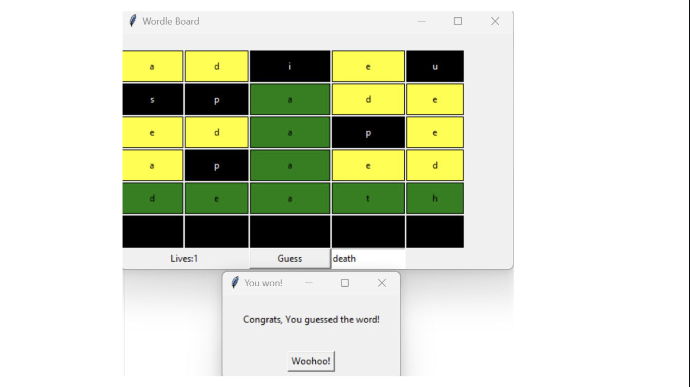
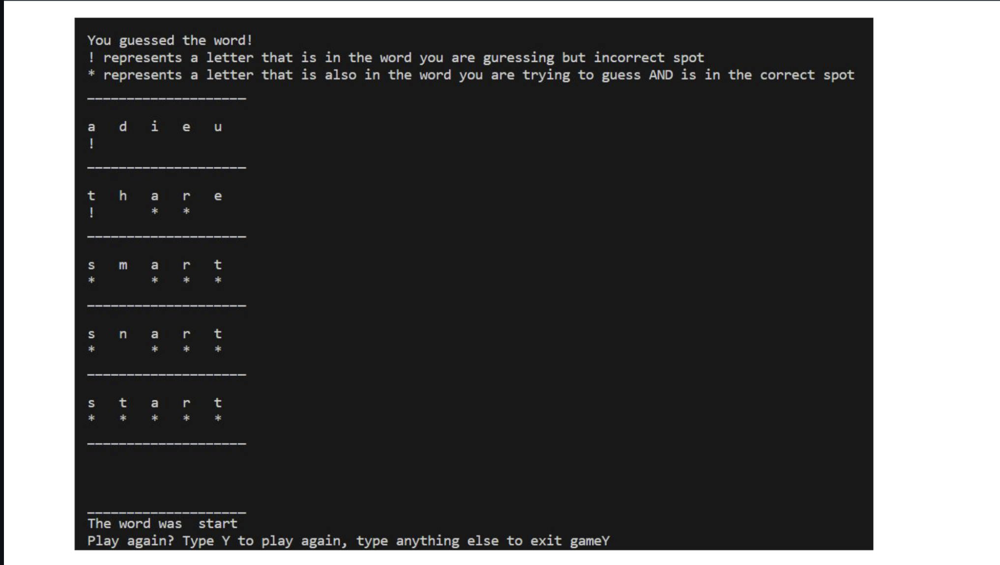
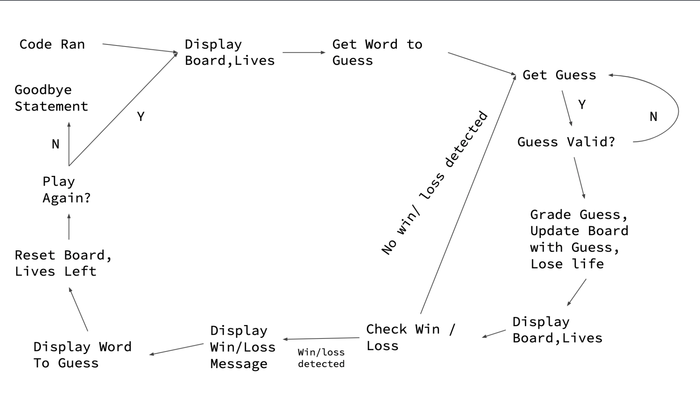

# 📝 Wordle Clone

## 👀 Supports Both GUI views...
<p align="center">
  
</p>

## 🖥️ And Terminal views!

<p align="center">
  
</p>


## 📝 Learn More Via this Slideshow... (Click it!)

<div align="center">
  <table>
    <tr>
      <td>
        <a href="Assets/WordlePres.pdf">
          
        </a>
      </td>
      <td>
        <a href="Assets/WordlePres.pdf">
          
        </a>
      </td>
    </tr>
  </table>
</div>

## About the project

This is the Final Project I did for EECE 2140 at Northeastern with Professor Roi Yehoshua. It is a terminal and GUI tkinter interface of the popular game Wordle.
The program utilized the Model View Controller method to oranize itself and its classes. This allows for easy future appendation and debugging. Run the MainConsole or MainGUI file to utilize the flexibility of the view and play in either your terminal or in a tkinter Graphical User Interface!

## Run from source

Install Python with Tkinter support, then run either entry point:

```powershell
python mainGUI.py
python mainConsole.py
```

## Build the Windows download

Use 64-bit Windows Python (the release build uses Python 3.14). From the repo folder:

```powershell
python -m venv .venv
.\.venv\Scripts\Activate.ps1
python -m pip install -r requirements-build.txt
.\build-windows.ps1
```

The script runs the regression tests, then builds `dist/Wordle-Clone.exe` using
PyInstaller. Keep generated build files out of Git. If script activation is disabled,
add `.venv\Scripts` to the current terminal's PATH instead of changing system policy.

### Publish a release

1. Complete the checks in [RELEASING.md](RELEASING.md).
2. Commit and push the tested source changes.
3. Create a GitHub Release for tag `v1.0.0` (increment the version for later releases).
4. Attach `dist/Wordle-Clone.exe`, describe changes, and publish after testing.

The download link below always points to the executable in the latest release.

## Download for Windows

**[Download Wordle-Clone.exe](https://github.com/rahulabtar/Wordle-Clone/releases/latest/download/Wordle-Clone.exe)**

For Windows x64. Download the executable and double-click it to play the GUI game.
No Python installation, installer, or internet connection is needed to play.
The executable includes the word list. You can keep it in any folder.

The GitHub "Source code" downloads are for developers; players should choose
`Wordle-Clone.exe` under the release's Assets.

This first version is unsigned, so Windows may show a publisher/reputation warning.
